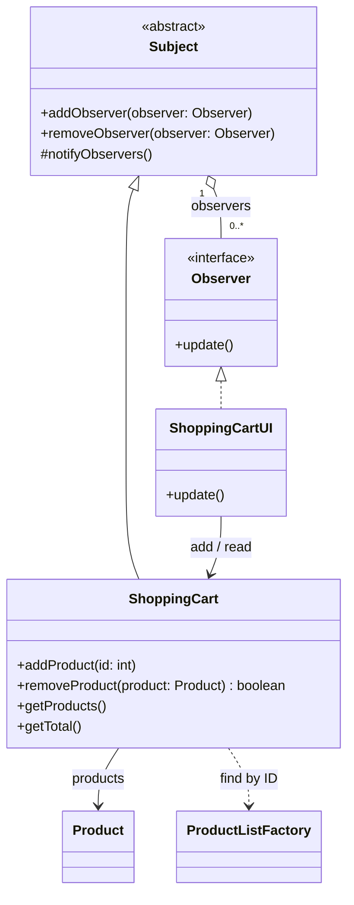
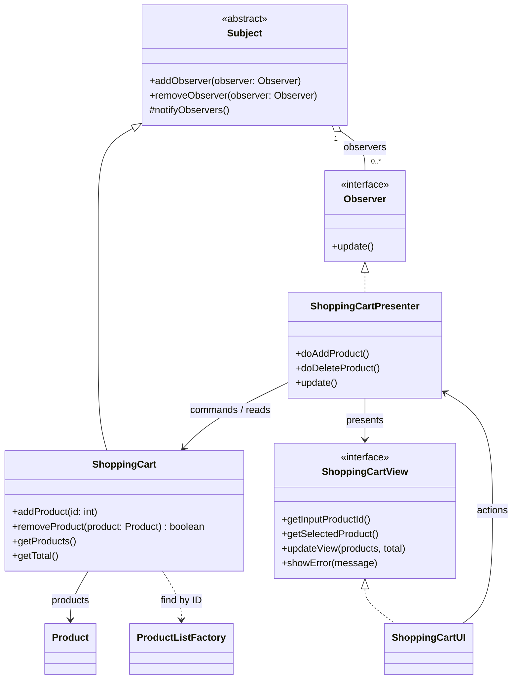

# A4.6 — Observer e MVP

**Tópicos Avançados de POO · 2026/27**

Nesta atividade, uma app para gestão de um carrinho de compras serve para comparar duas formas de organizar a aplicação. Primeiro, a interface comunica diretamente com o Model e usa **Observer** para reagir às suas alterações. Depois, o **Presenter** assume a coordenação entre a View e o Model.

O projeto contém o modelo do carrinho (`ShoppingCart`, `Product`, `ProductListFactory`) e uma interface gráfica inicial. `ShoppingCart`, a interface `Observer` e a classe abstrata `Subject` são fornecidos **já implementados**, incluindo as operações de adição e remoção de produtos e a notificação dos observadores.

As duas versões devem poder ser executadas separadamente: `modelview.Main` para a primeira etapa e `mvp.Main` para a segunda. O código de MVP deve ficar no package `mvp`, mantendo a versão Model–View disponível para comparação. O Model do carrinho é partilhado entre as duas versões.

## Abrir e executar

Abra a pasta do projeto como **projeto Maven** no IntelliJ, com JDK 21. Pode executar o objetivo Maven `javafx:run` pela janela Maven da IDE ou, num terminal com Maven instalado:

```text
mvn clean javafx:run
```

Esta execução abre `modelview.Main`. Os IDs disponíveis são **1 a 5**; um ID inexistente deve produzir um erro quando a ligação ao Model estiver concluída. 

Os packages Java ficam em `src/main/java/pt/unips/estsetubal/tapoo/`: `model`, `observer`, `modelview` e `mvp`.

## Atividade preparatória — Explorar o ponto de partida

Execute `modelview.Main`, introduza o ID de um produto e carregue em **Add**. Observe que a lista e o total apresentados **não são atualizados**. Analise `ShoppingCart`, a classe da interface gráfica, `Subject` e `Observer`.

1. Que classe guarda os produtos e calcula o total? Que classe contém os controlos gráficos?
2. Que ligações faltam para a ação **Add** alterar o carrinho e a interface apresentar o novo estado?
3. Quando o Model mudar por outro ponto da aplicação, como pode a interface saber que deve atualizar-se?

## Atividade 1 — Model–View com Observer

**Problema:** a interface deve apresentar o estado atual do carrinho após uma alteração, mesmo quando esta não resulta de um clique na própria interface.

**Diagrama de classes esperado no final da atividade 1:**



**Requisitos:**

- Analise como `ShoppingCart` herda de `Subject` e notifica os observadores **uma vez**, após adicionar um produto com sucesso.
- Faça a View (`modelview.ShoppingCartUI`) implementar `Observer` e registe-a como observadora do carrinho.
- Complete a ação do botão **Add**: a View lê o ID e pede ao Model para adicionar o produto.
- Em `update()`, a View consulta os produtos e o total no Model e atualiza os controlos gráficos. Apresente também o estado inicial do carrinho.
- Um ID inexistente ou uma entrada inválida deve produzir uma mensagem de erro, sem alterar o carrinho nem emitir uma notificação de alteração.

O Model não deve depender de JavaFX nem conhecer `ShoppingCartUI`. Evite atualizar a lista diretamente no tratamento do clique: a apresentação do novo estado deve acontecer através de `update()`.

**Verificação:** adicione um produto pela interface e confirme a lista e o total. Altere também o mesmo `ShoppingCart` diretamente, fora do tratamento do botão, e confirme que a View reage. Experimente um ID inválido e confirme que o estado anterior se mantém.

## Atividade 2 — Evoluir para MVP

**Problema:** na versão Model–View, a View lê e interpreta o ID, invoca a operação no Model e decide como apresentar os erros. Separe estas responsabilidades, criando uma versão no package `mvp`.

**Diagrama de classes esperado no final da atividade 2:**



São fornecidos a interface `mvp.ShoppingCartView` e o `mvp.ShoppingCartPresenter`, com `doAddProduct()`, `doDeleteProduct()` e `update()` criados, mas por completar. Complete também a ligação indicada no construtor; não é necessário criar outra classe Presenter.

### Exercício 1 — Separar View e Presenter

**Requisitos:**

- Crie `mvp.ShoppingCartUI` para recolher as ações e apresentar produtos, total e mensagens. Esta View **não deve ter uma referência ao `ShoppingCart`**.
- Faça `ShoppingCartUI` implementar a interface `mvp.ShoppingCartView` fornecida, completando as operações de leitura e apresentação necessárias ao Presenter.
- Complete `doAddProduct()` no Presenter para receber a ação **Add**, interpretar o ID, invocar o Model e decidir que mensagem pedir à View em caso de erro. O Presenter deve depender da interface `ShoppingCartView`, sem aceder aos controlos JavaFX.
- Complete a ligação do Presenter ao `ShoppingCart` como `Observer`. Em `update()`, consulte o Model e peça à View que apresente a lista e o total, incluindo no arranque da aplicação.
- Crie `mvp.Main` para construir e ligar Model, View e Presenter, sem alterar a execução de `modelview.Main`.

**Atenção:** após uma operação bem-sucedida, a atualização da View deve resultar da notificação ao Presenter. Não a repita no método que trata o clique em **Add**.

### Exercício 2 — Adicionar Delete

Acrescente à View MVP um botão **Delete** que remove o produto selecionado na lista.

**Requisitos:**

- A View comunica a ação ao Presenter e disponibiliza o produto selecionado. Não remove diretamente o produto da lista gráfica.
- Complete `doDeleteProduct()` no Presenter para validar a seleção e solicitar a remoção ao `ShoppingCart`. Se não existir seleção, peça à View que apresente uma mensagem adequada.
- Utilize a operação `ShoppingCart.removeProduct(product)`, já implementada: devolve `true` e notifica quando remove um produto; devolve `false` sem notificar se o produto não existir no carrinho.
- Após a notificação, o Presenter consulta novamente o Model e a View apresenta a lista e o total atualizados.

## Verificação e entrega

Confirme os seguintes percursos nas **duas versões**, quando aplicável:

| Situação | Resultado esperado |
| --- | --- |
| Adicionar um produto válido | O produto aparece e o total é atualizado. |
| Introduzir um ID inválido | É apresentado um erro; lista e total mantêm-se. |
| Alterar o Model fora da ação **Add** | O observador atualiza a apresentação. |
| No MVP, carregar em **Delete** sem seleção | É apresentado um erro; o carrinho mantém-se. |
| No MVP, selecionar e remover um produto | O produto desaparece e o total é recalculado. |

Execute `modelview.Main` e `mvp.Main` e apresente os dois percursos. Compare a implementação com os diagramas UML e identifique os participantes de Observer em cada versão.

**Reflexão:** na primeira versão, quem observa o Model? Na segunda, quem o observa? Que responsabilidades deixaram de estar na View ao introduzir o Presenter?
